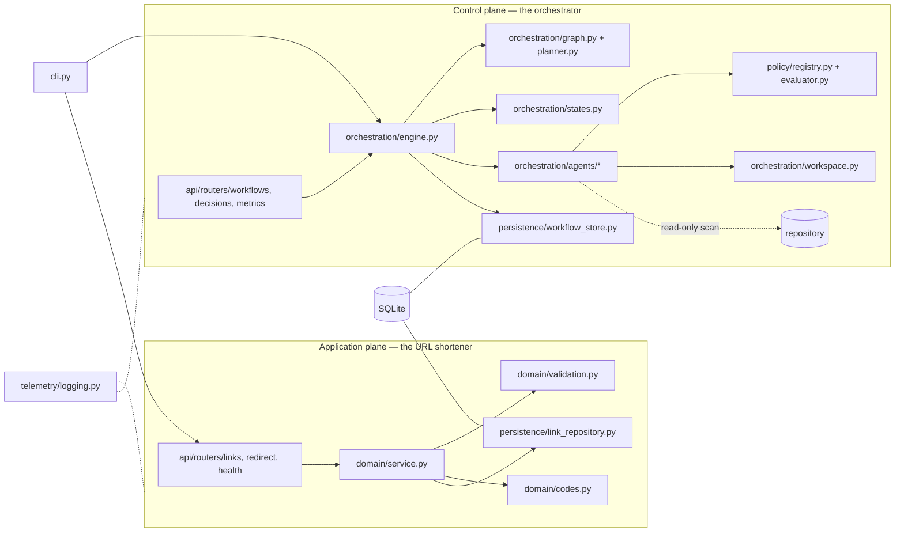
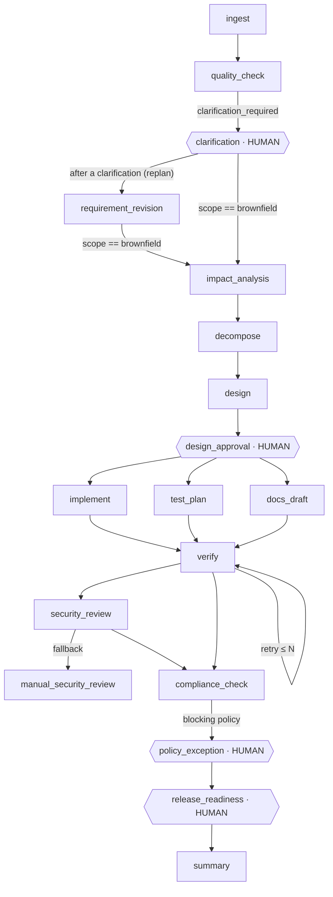
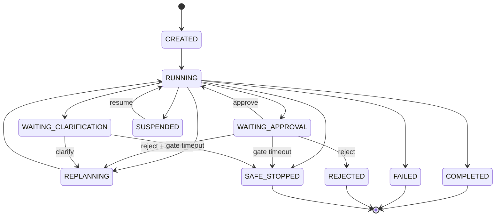

# Architecture Overview

This document describes what is built, how control flows through it, and
why the main decisions were made. Everything described here is implemented
and covered by tests; where something is a documented path rather than built
behaviour it says so. Decision rationale lives in [`adr/`](adr/README.md);
requirement identifiers (`FR-…`, `NFR-…`, `SCN-…`) refer to
[`specs/001-agentic-url-shortener/spec.md`](../specs/001-agentic-url-shortener/spec.md).

## 1. Two planes, one process



- **Application plane** (`domain`, `api/routers/links|redirect|health`,
  `persistence/link_repository.py`): deliberately small — create, redirect,
  expire, analytics, health, idempotency, rate limiting. It is the thing the
  orchestrator reasons about and changes.
- **Control plane** (`orchestration`, `policy`, `persistence/workflow_store.py`,
  `api/routers/workflows|decisions|metrics`): the dependency graph, state
  machines, scheduler, human gates, reliability controls, replanning, policy
  enforcement, audit trail and metrics.
- The two planes share only `persistence/db.py`, `telemetry`, `config` and
  `errors`. The import direction is a tested rule
  (`tests/architecture/test_import_rules.py`, ADR-001), not a convention.
- One process, one SQLite file. Production-grade *discipline* was the goal;
  production-*scale* infrastructure was explicitly out of scope (constitution,
  Assessment Constraints). §8 lists the scaling path.

## 2. The URL shortener

| Concern | Where | Behaviour |
|---|---|---|
| Validation (FR-U02/U03) | `domain/validation.py` | absolute URL, `http`/`https` only, length bound, literal loopback / link-local / RFC 1918 / ULA / cloud-metadata ranges and a hostname block-list rejected; DNS-resolving check is a documented production recommendation (AMB-03) |
| Short codes (FR-U04) | `domain/codes.py` | 7-char random base62 (`secrets`), bounded regeneration on collision (ADR-004) |
| Create / resolve / expire (FR-U01, U05, U06) | `domain/service.py` | expired → `410 Gone` (distinct from `404`); expiry in the past rejected at creation |
| Analytics (FR-U07/U08) | `persistence/link_repository.py` | best-effort recorder; a failed analytics write never fails the redirect (AMB-05); per-day grouping |
| Idempotency (FR-U09) | `domain/service.py` | same key + same payload → same code; same key + different payload → `409` |
| Failure handling (FR-U11, U13) | `api/problems.py`, `errors.py` | every error is RFC 9457 `application/problem+json` with a correlation ID and no stack trace; store failure → `503` |
| Health (FR-U12) | `api/routers/health.py` | liveness always; readiness pings the database |
| Auth / rate limit (AMB-06/07) | `api/auth.py`, `api/ratelimit.py` | static API key on mutating and workflow endpoints, `X-Actor` on decisions; in-process token bucket on creation |

The HTTP contract is versioned and exported
(`specs/001-agentic-url-shortener/contracts/openapi.yaml` + JSON schemas);
`tests/contract/test_openapi_drift.py` fails when the application and the
committed contract diverge.

## 3. The orchestration model

### 3.1 Graph

A run is an explicit dependency graph of `StageSpec` nodes built per run by
`planner.make_planner(settings)(ctx)` — a pure function of the run context.
Each node declares its agent, dependencies, owner (`agent` or `human`),
condition, retry policy, timeout, fallback agent, compensability, gate policy
and the artifact kinds it emits.



What makes it non-linear rather than a chain:

- **Conditional branches** — `clarification`, `impact_analysis` and
  `policy_exception` have named conditions evaluated against recorded context
  when they become ready; a false condition records a `stage_skipped` event
  with the condition label, which is how the greenfield run proves it *did not
  need* clarification (FR-O04, SCN-A).
- **Fan-out / join** — `implement`, `test_plan`, `docs_draft` share the same
  dependency set and run concurrently on a thread pool (tagged
  `parallel_group = after:design_approval`); `verify` is the join and starts
  only after all three have exited (FR-O03). `security_review` and
  `compliance_check` are sequential on purpose: the compliance evaluation must
  see the review's outcome (SEC-003).
- **Structure vs. runtime facts** — only facts that change through a governed
  decision shape the graph (initial scope, recorded clarifications); facts
  discovered by agents select branches through conditions. That split keeps
  the graph stable between loads and makes every structural change a
  `ReplanRecord` with a before/after diff (§3.5).

### 3.2 State machines

Closed transition tables in `orchestration/states.py`; anything else raises
`IllegalTransitionError`, which the engine turns into a safe-stop.



Stage states: `PENDING → READY → RUNNING → SUCCEEDED | FAILED | RETRYING →
RUNNING…`, `FAILED → FALLBACK`, `SUCCEEDED/FALLBACK → COMPENSATING →
COMPENSATED`, `PENDING → SKIPPED`, and `* → INVALIDATED → PENDING` on replan.

### 3.3 Scheduler and control flow of one tick

```mermaid
sequenceDiagram
  participant H as Human / CLI / API
  participant E as Engine
  participant S as WorkflowStore
  participant A as Agents (thread pool)
  H->>E: run(run_id)
  E->>S: load run, stages; rebuild graph from context
  loop until waiting / terminal
    E->>E: skip ready stages whose condition is false (event: stage_skipped)
    alt agent-owned stages are ready
      E->>A: execute batch concurrently (retry · timeout · fallback per stage)
      A-->>E: StageResult / StageError(kind)
      E->>S: stage state, outputs, artifacts (with lineage), events
    else a human-owned stage is ready
      E->>S: gate_opened event, run → WAITING_*
      E-->>H: returns (nothing but decide() advances it)
    else graph exhausted
      E->>S: run → COMPLETED, metrics snapshot
    end
  end
```

The engine is stateless between calls: every public method (`start`, `run`,
`decide`, `resume`, `stop`, `replan`) loads from the store, acts, persists.
That is what makes a run inspectable while it waits and resumable from a
different process (FR-O06, FR-O13).

### 3.4 Human-in-the-loop

Gates are nodes owned by `human` (ADR-007). `Engine.decide(run_id, gate,
actor, decision, reason, payload)` is the only path past a gate; it records a
`DecisionRecord` (actor, decision, reason, timestamp, artifact version) and
a `decision_recorded` event. Behaviour per decision:

| Decision | Effect |
|---|---|
| `approve` | gate `SUCCEEDED`, run `RUNNING`; a payload with `compensating_control` also grants scoped, expiring exceptions for the policies currently blocking (FR-G09) |
| `reject` | gate `FAILED`, compensation of side-effecting stages in reverse order, run `REJECTED` |
| `reject` + `return_to` | compensation, then replan from the named stage: governed rework instead of termination |
| `clarify` (clarification gates only) | requirement version +1, clarification recorded, replan, run `RUNNING` |

No decision ⇒ no progress; a gate with a configured timeout safe-stops with
`GATE_TIMEOUT` (FR-G04). Agents cannot call `decide`; the only registered
agent for a human stage is a sentinel that raises.

### 3.5 Reliability and recovery

| Control | Mechanism (all in `engine.py` unless stated) | Evidence |
|---|---|---|
| Failure classification | agents raise `StageError(kind=TRANSIENT or PERMANENT)`; timeouts are transient; unexpected exceptions are permanent | `failure_detected` event |
| Bounded retry + backoff | `RetryPolicy(max_attempts, base_delay, multiplier, max_delay)` per stage; each attempt recorded | `retry_scheduled`, `recovery_started/completed` |
| Timeout | per-attempt future timeout from `TimeoutPolicy` | `stage_timed_out` |
| Fallback | `StageSpec.fallback` agent after exhaustion; stage ends `FALLBACK`, result flagged | `fallback_used` |
| Rollback vs compensation (ADR-008) | `implement` applies a `ChangeSet` to the run workspace and keeps the inverse → `Workspace.revert` is a true rollback; other side-effecting stages implement `compensate()` | `rollback_completed` / `compensation_completed` |
| Safe-stop | retries exhausted without fallback, permanent failure, gate timeout, non-exceptionable mandatory policy FAIL (`POLICY_BLOCKED`), illegal transition, operator stop; terminal with reason | `safe_stop` event, `terminal_reason` |
| Resume | `Engine.resume` reloads; `RUNNING` stages found at load become `RETRYING` if eligible; succeeded stages are never re-run | `run_resumed` |
| Idempotency | execution keyed by `(run_id, stage, attempt)`; a succeeded stage is skipped by the ready-set computation | tests `test_reliability.py` |

### 3.6 Dynamic replanning (ADR-009)

Triggered by a clarification decision, a rejection with `return_to`, or an
explicit `Engine.replan(trigger, data_updates)`:

1. snapshot the current graph; 2. apply the change to the context
   (requirement version +1); 3. rebuild the graph with the same planner;
4. `WorkflowGraph.diff` → added / removed / changed stages; 5. invalidate the
   downstream closure (`INVALIDATED → PENDING`, artifacts marked invalidated);
6. persist a `ReplanRecord(before, after, invalidated)` and a `replan` event
   (graph version +1); 7. continue from the first invalidated stage.

Unaffected stages keep their state and attempt count; every gate downstream of
the change is re-armed — replanning never skips governance. The ambiguous
scenario's `replans.json` shows graph v1 → v2 adding `requirement_revision`.

### 3.7 Agents (ADR-010)

Agents implement one protocol (`execute(ctx, stage, attempt) → StageResult`,
optional `compensate`). They are deterministic for the assessment so every
scenario is reproducible offline; an LLM-backed agent is the same interface
(backlog). They are not trivial stubs:

- `ingest` / `quality_check` / `requirement_revision` — normalise, classify
  scope, derive acceptance criteria, detect ambiguity with severity from
  reviewable vocabularies (vague quantities, conflicts with approved
  requirements, out-of-boundary scope), and record *why* clarification is or
  is not needed.
- `impact_analysis` — scans the actual repository for the requirement's
  terms and reports impacted modules, OpenAPI paths, data flows, tests, docs,
  regression risks and rollback considerations (FR-O17).
- `decompose` / `design` — dependency-aware tasks with test-first ordering
  and parallel flags; components, API/schema impact, trade-offs, risks.
- `implement` — writes red-test scaffolds and a change plan **only into the
  run workspace** through a reversible `ChangeSet`.
- `verify` — executes a real command in a subprocess (the impacted regression
  targets, or a compile of the change set) with a timeout; records command,
  exit code and output.
- `security_review` (+ `manual_security_review` fallback),
  `compliance_check`, `summary` — see §4.

### 3.8 Context, lineage and audit (FR-O06, FR-O07, FR-O20)

`RunContext` carries the normalised requirement, stage outputs, artifact
references, decisions and assumptions; only the engine mutates it and every
mutation is persisted. Each artifact records `derived_from` (the upstream
artifact ids it was built from), its version and the policy version. The
event log is append-only and sequence-numbered; `reconstruct.py` rebuilds
stage states from events alone (tested, NFR-04). Every event carries actor
type, action, timestamp, target, result and reason.

## 4. Policy enforcement and release readiness (FR-G06..G10)

`policy/registry.py` is versioned (`POLICY_VERSION`); the version is stored on
every run and every evaluation. `compliance_check` evaluates all policies
against persisted events and artifacts and persists each outcome:

| Policy | Domain | Mandatory | Exceptionable | Checks |
|---|---|---|---|---|
| SEC-001 | security | yes | no | a change set touching `domain/validation.py` keeps the allow-list and blocked ranges |
| SEC-002 | security | yes | no | no secret patterns in any artifact (same patterns as the repository scan) |
| SEC-003 | security | yes | yes | automated review ran; a fallback to manual review requires a human-accepted exception |
| CMP-001 | compliance | yes | no | every executed stage has start and end events; every opened gate has a decision |
| CMP-002 | compliance | yes | no | events carry actor, action, timestamp, target |
| CHG-001 | change control | yes | yes | brownfield: `impact_analysis` succeeded before `implement` started |
| CHG-002 | change control | yes | yes | API/schema impact flagged by design ⇒ acknowledged at `design_approval` |
| DEP-001 | dependencies | advisory | yes | new dependencies' licences are allow-listed |
| AUD-001 | audit | advisory | yes | audit retention recorded on the run |

Blocking semantics: a mandatory `FAIL` or `EXCEPTION-REQUESTED` blocks unless
an *approved, unexpired* exception exists. Exceptionable blockers open the
`policy_exception` gate; non-exceptionable ones raise `PolicyBlockedError`
and the run safe-stops. `orchestration/release.py` computes the single
release decision (`READY` / `READY WITH ACCEPTED LIMITATIONS` / `NOT READY`)
from persisted facts, and is used by the release gate context, the summary
and `agentic-sdlc workflow release`.

## 5. Observability and metrics (FR-O19)

- structlog JSON logs bound with `run_id`, `stage`, `attempt`,
  `correlation_id`; key material redacted.
- `orchestration/metrics.py` computes from events: stage success/failure
  rates, retry count and frequency, timeouts, fallbacks, compensations,
  rollbacks, safe-stops, replans, recovery durations, **MTTR** (Σ recovery
  duration ÷ recovered failure events; unrecovered reported separately), and
  end-to-end latency split into active and human-wait time. Every export
  carries `measurement_type: demonstration`.
- Exposed at `GET /api/v1/metrics`, `GET /api/v1/workflows/{id}/metrics`,
  `agentic-sdlc workflow metrics`, and in every `docs/evidence/*/metrics.json`.

## 6. Security notes

Threats considered and the control for each:

| Threat | Control |
|---|---|
| Open redirect to dangerous schemes | scheme allow-list (`http`, `https`) at creation |
| SSRF through the redirector | literal loopback / link-local / private / ULA / metadata ranges and hostname block-list rejected; DNS-resolving variant recommended for production |
| Enumeration of short codes | 7-char random base62 (~3.5 × 10¹²), no sequential ids |
| Analytics poisoning | best-effort recording, coarse UA class only, no PII stored |
| Approval spoofing | API key + mandatory `X-Actor` on decisions; decisions are immutable records |
| Secret leakage | log redaction by key; artifact scan (SEC-002); repository scan in the quality gate |
| Error-page information disclosure | problem responses carry no stack trace, module path or key (tested) |
| Dependency risk | `pip-audit` and licence allow-list in `scripts/release_check.py` |

Residual: no real identity provider (static key is a documented assumption);
no DNS resolution; in-process rate limiting is per worker.

## 7. Key decisions (see ADRs for alternatives and consequences)

| Decision | Why | Rejected |
|---|---|---|
| Hand-built DAG + tick scheduler (ADR-005) | the orchestration *is* the deliverable; it must be inspectable, testable and explainable line by line | LangGraph / Temporal / Airflow — hides exactly the behaviour under assessment |
| Gates as graph nodes (ADR-007) | approval becomes a dependency like any other; it cannot be bypassed by configuration | callbacks / flags on stages |
| State rows + append-only events (ADR-006) | fast current state, full reconstruction, immutable audit | events only (slow reads) / rows only (no history) |
| Rollback only for workspace writes (ADR-008) | honesty: file writes are reversible, most real side effects are not — those get compensation | "everything rolls back" |
| Graph-diff replanning (ADR-009) | a replan is a visible, diffable structural change rather than ad-hoc state edits | mutating the live graph in place |
| Deterministic agents (ADR-010) | reproducible offline scenarios; the protocol is the LLM extension point | real LLM calls (non-reproducible, needs keys) |
| Policies as versioned code (ADR-011) | testable in isolation, reviewable in diffs, version recorded on every run | YAML rules engine |

## 8. Scaling path (documented, not built)

- Persistence behind ports: swap SQLite for Postgres (Alembic migrations)
  without touching domain or engine code.
- Workers: the scheduler already executes batches on a thread pool and the
  engine is stateless between calls; multi-process execution needs a lease
  column on `workflow_stages` and a store-backed queue.
- Analytics: outbox table + worker for at-least-once delivery.
- Rate limiting at the gateway; identity provider for actors.
- Observability: OTLP exporter with one span per stage attempt.

See [`../BACKLOG.md`](../BACKLOG.md) for the full deferred list and the
reasoning.
